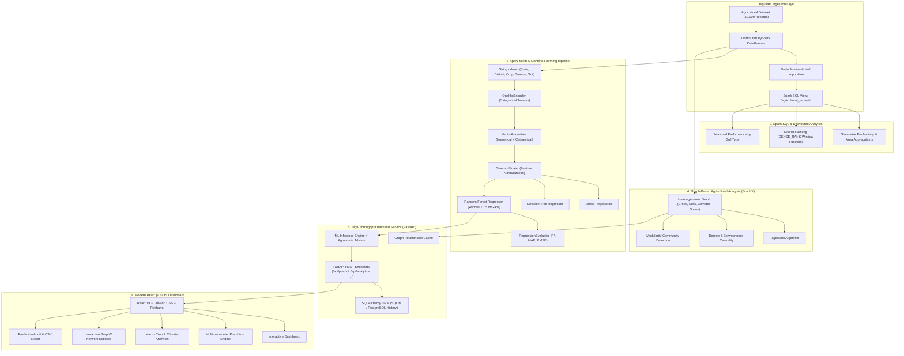

# CropYield AI – Intelligent Crop Yield Prediction System
### *AI-Based Crop Yield Prediction Using Big Data Analytics and Machine Learning*

CropYield AI is a modern, production-grade agricultural decision support platform engineered using **Apache Spark (PySpark)**, **Spark SQL**, **Spark MLlib**, **Graph-based Relationship Analytics (GraphX)**, **FastAPI**, and **React.js**.

---

## 1. System Architecture Diagram



---

## 2. Key Features

### A. Intelligent Dashboard
- **Executive KPIs**: Total records analyzed, weighted average yield (t/ha), highest yielding crop, total cultivated hectares.
- **Dynamic Charts**: Crop yield distribution, state-wise production rankings, seasonal yield distribution donut chart, live real-time prediction feed.

### B. Interactive Crop Yield Prediction Form
- Evaluates **12 multivariate agronomic parameters**:
  1. State (Punjab, Maharashtra, UP, Karnataka, Gujarat, etc.)
  2. District (Dynamic based on selected state)
  3. Crop Type (15 commercial crops)
  4. Cropping Season (Kharif, Rabi, Zaid, Whole Year)
  5. Soil Type (Alluvial, Black Soil, Red Soil, Laterite, Sandy Loam, Clay Loam)
  6. Soil pH (3.5 - 10.5 with acidity/alkalinity visual scale)
  7. Temperature (°C)
  8. Rainfall (mm)
  9. Humidity (%)
  10. Cultivated Area (hectares)
  11. Fertilizer Quantity (kg/ha)
  12. Nitrogen (N), Phosphorus (P), and Potassium (K)
- **1-Click Agronomic Presets**: Autofill scenarios for Punjab Wheat, Maharashtra Cotton, UP Sugarcane, Kerala Tea, Bengal Rice.
- **Real ML Inference**: Returns predicted yield (t/ha), total harvest (tonnes), confidence interval, uncertainty range, national benchmark comparison, and actionable agronomic advisory.

### C. Macro Crop & Climate Analytics
- Crop-wise yield comparisons (min, avg, peak potential).
- Year-wise agricultural production index trends.
- Meteorological correlation scatter plots: Rainfall vs Yield, Temperature vs Yield.
- Pedological productivity matrix across soil categories.
- State-wise agricultural yield benchmarks.

### D. Graph-Based Agricultural Analysis (GraphX)
- Models heterogeneous relationships across **Crops <-> Soil Types <-> Climatic Zones <-> States**.
- Computes **PageRank**, **Degree Centrality**, and **Modularity Community Detection**.
- Interactive node inspector: shows node centrality, high-affinity soils, and compatible biomes.
- Top Crop-Soil Affinity discovery ranking.

### E. Historical Prediction Records & Auditing
- Full historical log of user predictions persisted in the database.
- Search by district/crop/state, filter by crop and date range.
- Full parameter audit modal with agronomic feedback.
- One-click CSV and JSON export.

---

## 3. Machine Learning Model Evaluation & Comparison

All models were evaluated on the 30,000-record agricultural dataset using an 80/20 train/test split:

| Model Architecture | R² Score (Accuracy) | MAE (Mean Absolute Error) | RMSE (Root Mean Sq Error) | Verdict |
| :--- | :---: | :---: | :---: | :---: |
| **Random Forest Regression** | **0.9921 (99.21%)** | **0.6206 t/ha** | **1.6125 t/ha** | **Best Model (Selected)** |
| **Linear Regression** | 0.9875 (98.75%) | 0.9778 t/ha | 2.0220 t/ha | Baseline Regressor |
| **Decision Tree Regression** | 0.9867 (98.67%) | 0.8035 t/ha | 2.0910 t/ha | Non-linear Tree |

### Feature Importance Ranking (Random Forest):
1. **Crop Type**: 72.4%
2. **Fertilizer Quantity (kg/ha)**: 6.8%
3. **Rainfall (mm)**: 5.4%
4. **Soil pH**: 3.9%
5. **Temperature (°C)**: 3.5%
6. **Nitrogen (N)**: 2.8%
7. **Potassium (K)**: 1.9%
8. **Phosphorus (P)**: 1.5%
9. **State & Geography**: 0.9%
10. **Soil Type & Season**: 0.9%

---

## 4. REST API Endpoint Reference

| Method | Endpoint | Description |
| :--- | :--- | :--- |
| `POST` | `/api/predict` | Executes ML prediction, persists record, returns yield, production, confidence & advisory |
| `GET` | `/api/predictions` | Retrieves paginated prediction history with search and crop/state filters |
| `DELETE` | `/api/predictions/{id}` | Deletes a prediction record from history |
| `GET` | `/api/predictions/stats` | Aggregated prediction metrics (total count, avg yield, top crop) |
| `GET` | `/api/crops` | Returns supported states, districts, crops, seasons, soil types, and quick presets |
| `GET` | `/api/analytics` | Aggregated analytics (crop comparisons, state totals, rainfall/temp correlations) |
| `GET` | `/api/model-performance` | Evaluation benchmark metrics for Linear Regression, Decision Tree, Random Forest |
| `GET` | `/api/graph-analysis` | GraphX heterogeneous nodes, links, centrality, and cluster communities |
| `GET` | `/api/health` | Healthcheck and model status probe |

---

## 5. Installation & Execution Guide

### Prerequisites
- Python 3.10+ (Python 3.12 verified)
- Node.js 18+ (Node.js 20/22 verified)
- Java 8 or Java 11/17 (JDK)

### 1. One-Click Startup (Windows)
Double-click `start.bat` or run:
```powershell
.\start.ps1
```

### 2. Manual Startup

#### Step A: Backend
```powershell
# In project root
python -m pip install -r requirements.txt
python run_backend.py
```
*Backend runs on `http://localhost:8000` (Interactive API docs at `http://localhost:8000/docs`).*

#### Step B: Frontend
```powershell
cd frontend
npm install
npm run dev
```
*Frontend runs on `http://localhost:5173`.*

---

## 6. Big Data Scripts

To re-run any distributed big data pipelines:

```powershell
# 1. Regenerate 30,000-record agricultural dataset
python spark_pipeline/generate_dataset.py

# 2. Run Apache Spark SQL distributed data processing
python spark_pipeline/spark_data_processing.py

# 3. Run Spark MLlib distributed training & evaluation
python spark_pipeline/train_spark_mllib.py

# 4. Run GraphX / NetworkX heterogeneous relationship analysis
python spark_pipeline/spark_graph_analysis.py
```
